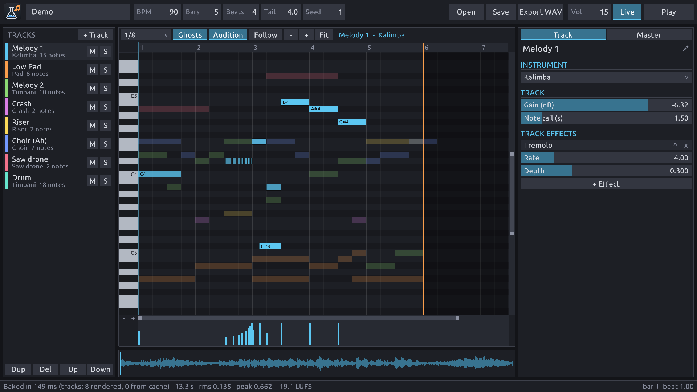

  

<h1 align="center">Synth Lab</h1>

  A little song editor made in NioScript to show off Nio's <code>Synth</code> API. 
  No audio files anywhere. Every sound comes from script.

## Try it

**Just want to play with it?** Grab the latest build from [Releases](../../releases), unzip it and
run it. Press <kbd>Space</kbd> to hear the demo song.

**Have the Nio Editor?** Clone the repo, open the project and hit Play.

Songs save as plain text in a `Songs/` folder next to the app, and **Export WAV** drops
the loop in `Assets/Audio/`.

## Shortcuts

| | |
| --- | --- |
| <kbd>Space</kbd> | Play / stop |
| <kbd>Ctrl</kbd> + <kbd>S</kbd> | Save |
| <kbd>Ctrl</kbd> + <kbd>Z</kbd> | Undo |
| <kbd>Ctrl</kbd> + <kbd>Y</kbd> | Redo |

### Notes

| | |
| --- | --- |
| Click | Add a note (keep dragging to set its length) |
| Drag | Move a note, or resize it from its right edge |
| Right-click | Delete a note |
| <kbd>Shift</kbd> + drag | Box select |
| <kbd>Shift</kbd> + click | Add to / remove from the selection |
| <kbd>Ctrl</kbd> + <kbd>A</kbd> | Select all |
| <kbd>Esc</kbd> | Deselect |
| <kbd>Delete</kbd> | Delete the selection |
| <kbd>Ctrl</kbd> + <kbd>C</kbd> / <kbd>V</kbd> | Copy / paste at the playhead |
| <kbd>Ctrl</kbd> + <kbd>D</kbd> | Duplicate |
| <kbd>←</kbd> <kbd>→</kbd> | Nudge in time |
| <kbd>↑</kbd> <kbd>↓</kbd> | Nudge a semitone (<kbd>Shift</kbd> for an octave) |

Drag across the bars under the grid to set each note's volume. Click the piano keys to hear the instrument.

### Getting around

| | |
| --- | --- |
| Wheel | Scroll pitch |
| <kbd>Shift</kbd> + wheel | Scroll time |
| <kbd>Ctrl</kbd> + wheel | Zoom time |
| <kbd>Alt</kbd> + wheel | Zoom pitch |
| Middle-drag | Pan |
| Click the ruler | Move the playhead (drag to scrub) |
| <kbd>F</kbd> | Fit the whole song |
| <kbd>Z</kbd> | Zoom to the selection |
| <kbd>+</kbd> / <kbd>-</kbd> | Zoom in / out |
| <kbd>Home</kbd> / <kbd>End</kbd> | Jump to the start / end |

You can also grab either end of a scrollbar to zoom.

### Sliders

| | |
| --- | --- |
| Drag | Change the value (<kbd>Shift</kbd> for fine) |
| Wheel | Step it |
| Right-click | Type a value |
| <kbd>Ctrl</kbd> + right-click | Reset |